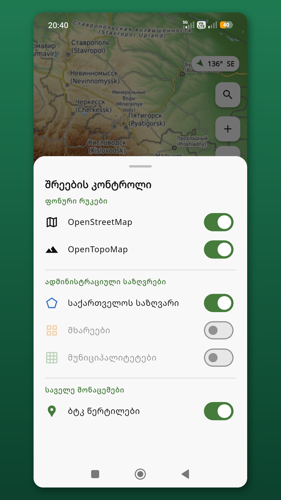
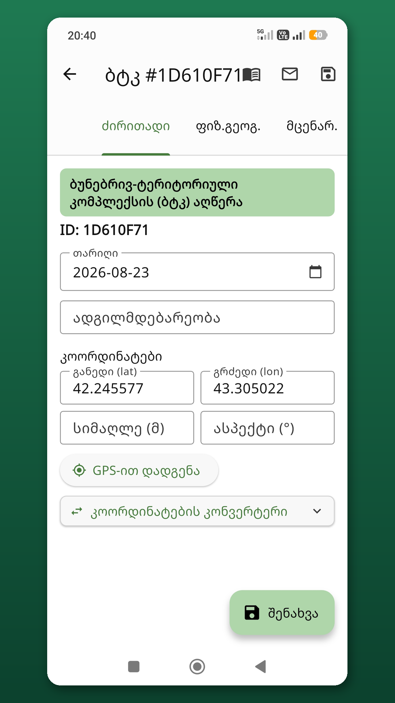
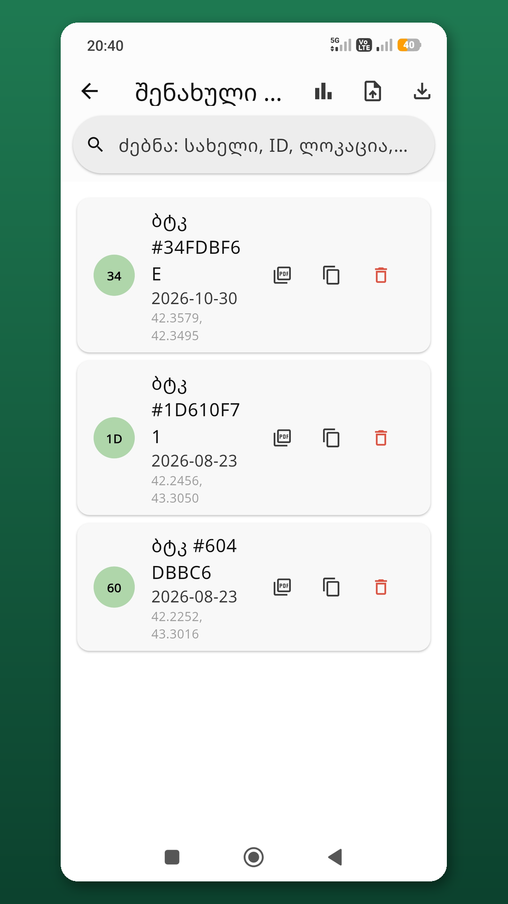
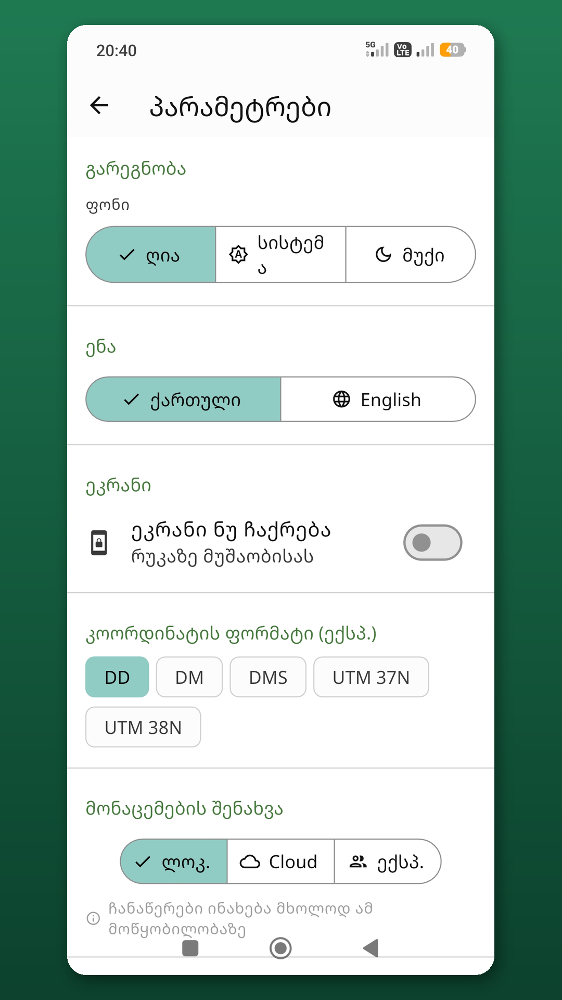
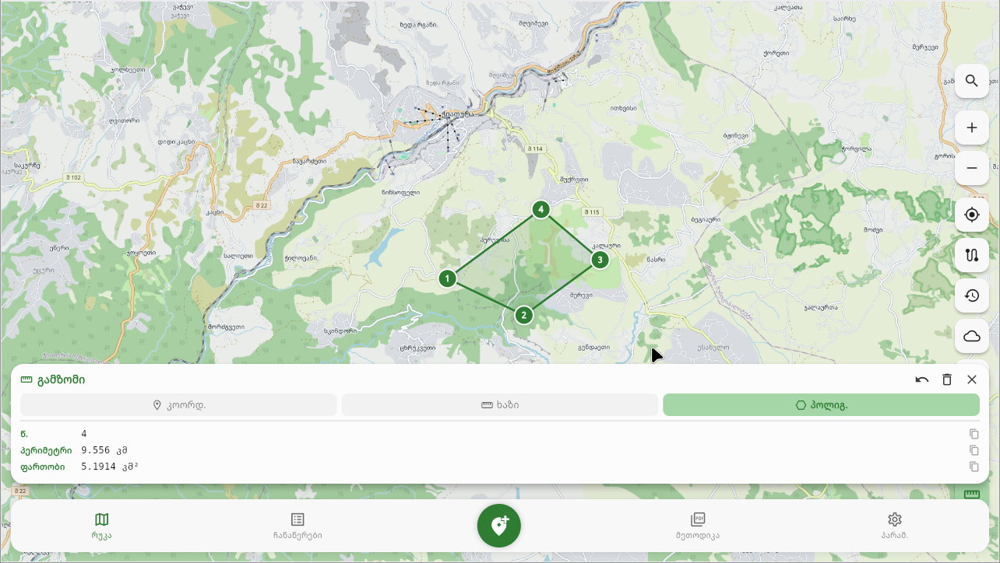
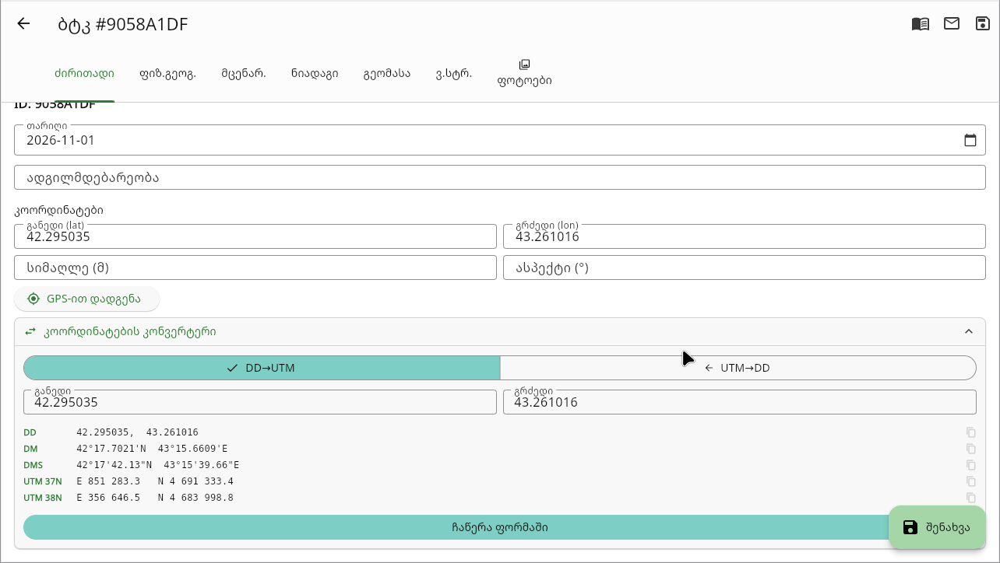

# ბტკ საველე აპლიკაცია · BTC Field App

[](https://btc.qgis.ge)
[](https://github.com/Georgian-Cartographers-Association)
[](https://github.com/Georgian-Cartographers-Association/GCA-btc-field-app/actions/workflows/release.yml)
[](https://github.com/Georgian-Cartographers-Association/GCA-btc-field-app/releases/latest)
[](https://github.com/Georgian-Cartographers-Association/GCA-btc-field-app/releases)
[](https://github.com/Georgian-Cartographers-Association/GCA-btc-field-app/releases/latest)
[](https://github.com/Georgian-Cartographers-Association/GCA-btc-field-app/releases/latest)
[](https://github.com/Georgian-Cartographers-Association/GCA-btc-field-app/releases/latest)
[](https://github.com/Georgian-Cartographers-Association/GCA-btc-field-app/releases/latest)
[](https://github.com/Georgian-Cartographers-Association/GCA-btc-field-app/releases/latest)
[](https://flutter.dev)
[](LICENSE)
[](https://doi.org/10.5281/zenodo.22171694)
[](https://deepwiki.com/Georgian-Cartographers-Association/GCA-btc-field-app)

თბილისის სახელმწიფო უნივერსიტეტისა და **[საქართველოს კარტოგრაფთა ასოციაციის](https://github.com/Georgian-Cartographers-Association)** ერთობლივი პროექტი — **ბუნებრივ-ტერიტორიული კომპლექსების (ბტკ) ველური კვლევის ღია კოდის პლატფორმა.** მუშაობს ვებ-ბრაუზერში, Android ტელეფონზე, Windows-სა და Linux-ზე — მონაცემები ნაგულისხმევად მოწყობილობაზე რჩება, ღრუბლოვანი სინქრონიზაცია არასავალდებულოა.

A joint project of Tbilisi State University and the **Georgian Cartographers Association** — a free, open-source field survey platform for **landscape natural-territorial complexes (NTC/BTC)**. Runs on the web, Android, Windows, and Linux, with your data stored locally by default and optional cloud sync.

- **[Launch BTC Web](https://btc.qgis.ge)** — სრული აპლიკაცია ბრაუზერში, ინსტალაცია არ სჭირდება
- **[Download the app](https://github.com/Georgian-Cartographers-Association/GCA-btc-field-app/releases/latest)** — Android APK, Windows Setup/Portable, Linux AppImage/.deb/.rpm
- **[ბტკ ბლანკი](https://github.com/Georgian-Cartographers-Association/GCA-btc-field-app/releases/latest)** — 6-სექციანი ფიზიკურ-გეოგრაფიული ბლანკი GPS-ით, კოორდინატების კონვერტერით, ფოტოებით
- **[Import / Export](https://github.com/Georgian-Cartographers-Association/GCA-btc-field-app/releases/latest)** — .btk, .btkz (ფოტო+GPS), PDF, KML, GeoJSON, CSV, GPX
- **[სტატისტიკა](https://btc.qgis.ge)** — dashboard: ჩანაწერების ანალიზი, bar charts, mini-map
- **[GPS ტრეკი](https://btc.qgis.ge)** — ჩაწერა → GPX ექსპორტი → .btkz-ში ავტოჩართვა
- **[რუქის ინსტრუმენტები](https://btc.qgis.ge)** — მანძილისა და ფართობის გაზომვა, ძიება, ამინდი, საკუთარი WMS/XYZ სერვისები

## Screenshots

<table>
  <tr>
    <td width="33%"><a href="docs/screenshots/play/1_map_layers.png"></a></td>
    <td width="33%"><a href="docs/screenshots/play/2_record_form.png"></a></td>
    <td width="33%"><a href="docs/screenshots/play/3_records_list.png"></a></td>
  </tr>
  <tr>
    <td align="center"><b>რუქის ფენები</b></td>
    <td align="center"><b>ბტკ ბლანკი</b></td>
    <td align="center"><b>ჩანაწერები</b></td>
  </tr>
  <tr>
    <td width="33%"><a href="docs/screenshots/play/4_settings.png"></a></td>
    <td width="33%"><a href="docs/screenshots/desktop_map_measure.png"></a></td>
    <td width="33%"><a href="docs/screenshots/desktop_coord_converter.png"></a></td>
  </tr>
  <tr>
    <td align="center"><b>პარამეტრები</b></td>
    <td align="center"><b>გაზომვა (Linux)</b></td>
    <td align="center"><b>კონვერტერი (Linux)</b></td>
  </tr>
</table>

## რა არის ბტკ?

> **ბტკ = ბუნებრივ-ტერიტორიული კომპლექსი**
> ლანდშაფტური გეოგრაფიის ფუნდამენტური სტრუქტურული ერთეული — ტერიტორიის ის ნაწილი, სადაც **რელიეფი, ნიადაგი, მცენარეულობა, ჰიდროლოგია და მიკროკლიმატი** ერთიან, ურთიერთდაკავშირებულ სისტემას ქმნიან.

ეს აპლიკაცია გამიზნულია **პირდაპირ ველში** ბტკ-ების კომპონენტების აღწერისა და გაზომვებისთვის, ნ. ბერუჩაშვილის **ლანდშაფტურ-გეოფიზიკური კვლევის** მეთოდიკის მიხედვით.

## ჩამოტვირთვა

| პლატფორმა | ფაილი | შენიშვნა |
|---|---|---|
| **Android** | `btk-android-arm64.apk` | თანამედროვე ტელეფონები (რეკომენდ.) |
| **Android** | `btk-android-arm32.apk` | ძველი ტელეფონები |
| **Android** | `btk-android-x86_64.apk` | ემულატორები |
| **Android** | `app-release.aab` | CI-ის არტეფაქტი; Google Play-ზე იტვირთება ლოკალურად აწყობილი AAB ([docs/release](docs/release/ANDROID_RELEASE_BUILD.md)) |
| **Windows** | `btk-windows-setup-X.Y.Z.exe` | ინსტალერი (Start Menu) |
| **Windows** | `btk-windows.zip` | Portable — unzip და გაუშვი |
| **Linux** | `btk-linux-X.Y.Z.AppImage` | ნებისმიერი distro — `chmod +x` |
| **Linux** | `btk-linux-X.Y.Z.deb` | Debian / Ubuntu / Mint |
| **Linux** | `btk-linux-X.Y.Z.rpm` | Fedora / RHEL / openSUSE |
| **Web** | — | **[btc.qgis.ge](https://btc.qgis.ge)** |

SHA256 checksums: `checksums-android.txt` · `checksums-windows.txt` · `checksums-linux.txt`

**Google Play:** აპლიკაცია (`ge.btc.field_app`) გამოსაქვეყნებლად მზადდება და ჯერ საჯაროდ არ არის ხელმისაწვდომი.

> [!IMPORTANT]
> Android-ის პაკეტის სახელი შეიცვალა: `ge.cartographers.btk_field_app` → `ge.btc.field_app`. ახალი ვერსია ძველ APK-ს (v1.20.2 და უფრო ძველი) ვერ განაახლებს და ცალკე აპლიკაციად დაყენდება. ადგილობრივი ჩანაწერების გადასატანად ძველ აპლიკაციაში გააკეთეთ `.btkz` ექსპორტი, ახალში კი იმპორტი.

<details>
<summary>ინსტალაციის ინსტრუქციები</summary>

**Android** — `Settings → Install unknown apps → ჩართეთ → APK გაუშვეთ`

**Linux (AppImage)**
```bash
chmod +x btk-linux-*.AppImage && ./btk-linux-*.AppImage
```

**Linux (Debian/Ubuntu)**
```bash
sudo dpkg -i btk-linux-*.deb && sudo apt-get install -f
```

</details>

## ფუნქციები

### ბტკ ბლანკი — 6 სექცია + ფოტოები

| # | სექცია | ველები |
|---|---|---|
| 1 | **ძირითადი** | ID, სახელი, თარიღი, GPS კოორდინატები, სიმაღლე, ექსპოზიცია, ლოკაცია, კოორდინატების კონვერტერი |
| 2 | **ფიზ.-გეოგ.** | გეოლ. ფორმაცია, რელიეფი, მორფ. დახასიათება, მიგრ. რეჟიმი, ტენიანობა |
| 3 | **მცენარეულობა** | ვ.სტრუქტ. ტიპი/ინდ., იარუსები, სახეობები, სიმ./სიმძლ./ფენოფაზა |
| 4 | **ნიადაგი** | ტიპი, ჰორიზონტები, გეოჰ. ინდ., ზ.ფენ. ფორმ. + ფოტოები |
| 5 | **გეომასა** | სექციები — პედო / ლითო / ჰიდრო / ფიტომასა |
| 6 | **ვ.სტრუქტურა** | ტიპი, ინდ., სიმ., აღწ. + ფოტოები |
| + | **ფოტოები** | ჩანაწერის ყველა ფოტო, კამერიდან ან გალერეიდან (ვებ-ვერსიაში არ არის) |

### ექსპორტი და იმპორტი

| ფორმატი | შიგთავსი | |
|---|---|---|
| **.btk** | JSON — ჩანაწერების სრული მონაცემები | import ✓ · export ✓ |
| **.btkz** | ZIP — ჩანაწერები + ფოტოები + GPS ტრეკები | import ✓ · export ✓ |
| **PDF** | A4, ქართული ფონტი (Noto Sans Georgian), ფოტოები | export · share |
| **KML** | Google Earth / QGIS / ArcGIS | export · share |
| **GeoJSON** | QGIS / Mapbox / Leaflet | export · share |
| **CSV** | Excel / Sheets — 5 კოორდინატთა ფორმატი | export · share |
| **GPX** | GPS ტრეკი — Garmin / OsmAnd / Strava | export · share |

ყველა ფორმატი **Android, Windows და Linux**-ზე სრულად მუშაობს.

### რუქა და GPS

- **OpenStreetMap** + **OpenTopoMap** tile overlay-ები
- მზა სერვისები: **Esri** (Satellite, World Topo, World Street, NatGeo) და **CARTO** (Voyager, Light, Dark)
- საკუთარი **WMS / XYZ** სერვისების დამატება
- **გაზომვა რუქაზე** — კოორდინატი, მანძილი, ფართობი და პერიმეტრი
- **ადგილების ძიება** (Nominatim / OpenStreetMap)
- **ამინდის პროგნოზი** (api.met.no) და **კომპასი**
- ლოკალური **რასტრული რუქები** — Bounding Box + გამჭვირვალობა (ნიადაგი, ლანდშაფტი, რელიეფი)
- საქართველოს ადმინ. საზღვრები (GeoJSON) — რეგიონები, მუნიციპალიტეტები
- **GPS ტრეკის ჩაწერა** — ტრეკის ისტორია, GPX ექსპორტი. ფონური ჩაწერა არ არის, ამიტომ ჩართეთ „ეკრანი ნუ ჩაქრება“
- ტრეკი **ავტომატურად .btkz-ში** — ჩანაწერების მიმდებარე დღის ტრეკები

### UX

| ფუნქცია | |
|---|---|
| Long-press → multi-select | batch export / batch PDF / batch წაშლა |
| Record duplication | "(ასლი)" სუფიქსით |
| Discard dialog | unsaved changes გაფრთხილება |
| Auto-update banner | GitHub Releases-ს ამოწმებს, ახალი ვერსია → banner |
| სტატისტიკა / Dashboard | bar chart, სიხშირე, mini-map |
| ღია / მუქი ფონი | Material 3 theming |
| ქართული / English | ენის გადართვა პარამეტრებიდან |
| კოორდინატთა ფორმატები | DD, DM, DMS, UTM 37N, UTM 38N |
| ეკრანი ნუ ჩაქრება | რუქაზე მუშაობისას |
| ჩანაწერის გაგზავნა | ელფოსტით, ბლანკიდან |
| მეთოდიკა | PDF აპლიკაციის შიგნით |

### შენახვის რეჟიმები

| რეჟიმი | |
|---|---|
| **Local** | SQLite — მოწყობილობაზე, ინტერნეტი არ სჭირდება |
| **Cloud** | Firebase Firestore — real-time sync; საჭიროა ანგარიში |
| **Expedition** | გუნდური — ექსპედიციის კოდით; საჭიროა ანგარიში |

რეგისტრაცია შეზღუდულია: ელფოსტა ადმინისტრატორმა უნდა დაამატოს ნებადართულთა სიაში (`allowed_users`).

### ანგარიში და კონფიდენციალურობა

- **ანგარიშის წაშლა აპლიკაციიდან:** პარამეტრები → მონაცემების შენახვა → ანგარიშის წაშლა. იშლება ანგარიში და ღრუბელში შენახული ჩანაწერები. მოწყობილობაზე შენახული და ექსპედიციაში გაზიარებული ჩანაწერები რჩება.
- **[Privacy Policy](https://btc.qgis.ge/privacy.html)** — რა მონაცემებს ამუშავებს აპლიკაცია და რატომ.

## Development

```bash
git clone https://github.com/Georgian-Cartographers-Association/GCA-btc-field-app.git
cd GCA-btc-field-app
flutter pub get
flutter gen-l10n
flutter run                                        # OS auto-detect
flutter run -d windows                             # Windows desktop
flutter build apk --split-per-abi --release        # Android APKs (arm64, arm32, x86_64)
flutter build appbundle --release                  # AAB (Google Play)
flutter build windows --release                    # Windows
flutter build linux --release                      # Linux
flutter build web --release                        # Web
```

Linux-ზე აწყობისთვის (Ubuntu/Debian, clang 18):

```bash
sudo apt-get install -y clang ninja-build lld-18 libgtk-3-dev libblkid-dev liblzma-dev libsecret-1-dev libjsoncpp-dev
flutter run -d linux
```

### Google Play გამოშვება

აპლიკაცია იყენებს Play App Signing-ს ცალკე upload key-ით. გასაღები რეპოში არ ინახება, ხოლო release build გასაღების გარეშე შეცდომით ჩერდება.

- [Upload key setup](docs/release/UPLOAD_KEY_SETUP.md)
- [Android release build](docs/release/ANDROID_RELEASE_BUILD.md)
- [Key backup and recovery](docs/release/KEY_BACKUP_AND_RECOVERY.md)
- Store-ის გრაფიკა: [`docs/store/`](docs/store) (`generate_art.py` ხელახლა ქმნის ხატულებს), სურათები: [`docs/screenshots/play/`](docs/screenshots/play)

## CI/CD

| Job | Trigger | Artifacts |
|---|---|---|
| `build-apk` | `git tag v*` | arm64 / arm32 / x86_64 APK + AAB + SHA256 |
| `build-windows` | `git tag v*` | Setup .exe + Portable .zip + SHA256 |
| `build-linux` | `git tag v*` | AppImage + .deb + .rpm + SHA256 |
| `pages.yml` | push to `main` | Web build → [btc.qgis.ge](https://btc.qgis.ge), მათ შორის `privacy.html` |

```bash
git tag v1.20.0 && git push origin v1.20.0
```

## არქიტექტურა

```
lib/
├── main.dart · router.dart          # Entry point, GoRouter
├── models/                          # BtkRecord, GpsTrack, Photo, …
├── database/btk_database.dart       # SQLite (sqflite_common_ffi)
├── data/
│   ├── repositories/                # Local / Cloud / Expedition / User
│   └── services/
│       ├── export_service.dart      # .btk .btkz PDF KML GeoJSON CSV GPX
│       ├── account_service.dart     # In-app account deletion
│       ├── sync_service.dart        # Cloud ⇄ local sync
│       ├── weather_service.dart     # api.met.no forecast
│       ├── analytics_service.dart   # Firebase Analytics events
│       └── update_service.dart      # GitHub Releases auto-update check
├── utils/                           # Coordinate conversion, UTM, measurement
└── features/
    ├── map/                         # FlutterMap, tile layers, measurement, search, weather
    ├── form/                        # 6-section BTC form + photo panels
    ├── records/                     # List, search, batch ops, import/export
    ├── stats/                       # Dashboard — charts + mini-map
    ├── gps/                         # Track recording + history
    ├── auth/                        # Firebase Auth
    ├── expedition/                  # Expedition mode
    ├── settings/                    # Storage mode, theme, locale, coord fmt
    ├── layers/                      # Raster and WMS/XYZ layer manager
    ├── raster/                      # Raster layer state
    └── pdf/                         # Methodology PDF viewer (164 გვ.)
```

## Tech Stack

| Package | |
|---|---|
| `flutter_map` + `flutter_map_cache` + `dio` | Tile layers with caching + raster overlay |
| `flutter_riverpod` | State management |
| `sqflite` + `sqflite_common_ffi` | SQLite (Android + Desktop) |
| `firebase_core` + `firebase_auth` + `cloud_firestore` | Accounts + cloud sync |
| `firebase_analytics` | Usage analytics |
| `geolocator` + `flutter_compass` | GPS, track recording, compass |
| `image_picker` | Photos from camera or gallery |
| `wakelock_plus` | Keep screen on |
| `file_picker` | File import / Save As dialog |
| `pdf` + `printing` | PDF export (Noto Sans Georgian) |
| `archive` | .btkz ZIP encoding/decoding |
| `share_plus` | Share files (mobile, desktop, web) |
| `http` | GitHub Releases API + weather |
| `package_info_plus` | Version for update check |
| `url_launcher` | Open release page |
| `go_router` | Navigation |
| `flex_color_scheme` | Material 3 theming |

## ციტირება · Citation

[](https://doi.org/10.5281/zenodo.22171694)

**ავტორი · Author:** გიორგი კაპანაძე / Giorgi Kapanadze  
**აფილიაცია · Affiliation:** ასოცირებული პროფესორი, Business and Technology University (BTU)  
**ორგანიზაცია · Organization:** [საქართველოს კარტოგრაფთა ასოციაცია / Georgian Cartographers Association](https://github.com/Georgian-Cartographers-Association)

პროგრამა შექმნილია სტუდენტებისთვის — ლანდშაფტური გეოგრაფიის საველე კვლევების სასწავლო და სამეცნიერო პრაქტიკისათვის.

თუ ამ პროგრამას კვლევაში იყენებთ, გთხოვთ, მიუთითოთ. GitHub-ის **"Cite this repository"** ღილაკი ([`CITATION.cff`](CITATION.cff)) APA და BibTeX ფორმატებს ავტომატურად გასცემს.

If you use this software, please cite it. Use GitHub's **"Cite this repository"** button ([`CITATION.cff`](CITATION.cff)) for a ready-made APA or BibTeX entry.

```bibtex
@software{kapanadze_btk_2026,
  author       = {Kapanadze, Giorgi},
  title        = {{BTK Field App} -- ბტკ საველე აპლიკაცია},
  year         = {2026},
  publisher    = {Zenodo},
  institution  = {{Business and Technology University (BTU)}},
  note         = {Member, Georgian Cartographers Association},
  doi          = {10.5281/zenodo.22171694},
  url          = {https://doi.org/10.5281/zenodo.22171694}
}
```

> Kapanadze, G. (2026). *BTK Field App — ბტკ საველე აპლიკაცია* [Computer software]. Business and Technology University (BTU); Georgian Cartographers Association. https://doi.org/10.5281/zenodo.22171694

## მადლობა · Acknowledgements

ეს პროგრამა აგებულია ღია კოდის გეოსივრცული და Flutter-ის საზოგადოებებზე, მათ შორის: flutter_map, OpenStreetMap, OpenTopoMap, Firebase, sqflite, Riverpod, GoRouter, Noto Sans Georgian, და სხვა. სრული სია `pubspec.yaml`-ში.

## ლიტერატურა

- ბერუჩაშვილი ნ. *საველე ლანდშაფტურ-გეოფიზიკური კვლევა და ლანდშაფტური კარტოგრაფირება.* თბ., 2024
- ბერუჩაშვილი ნ. *ბუნებრივ-ტერიტორიული კომპლექსების ლანდშაფტურ-გეოფიზიკური კვლევისა და მდგომარეობათა კარტოგრაფირების მეთოდიკა.* თბ., 1983
- გორდეზიანი თ. *ლანდშაფტური კარტოგრაფიის თეორიული საფუძვლები.* თბ., 2014

## License

[MIT](LICENSE)

---

<div align="center">

[Georgian Cartographers Association](https://github.com/Georgian-Cartographers-Association) · [Tbilisi State University](https://tsu.ge) · 2024–2026

</div>
